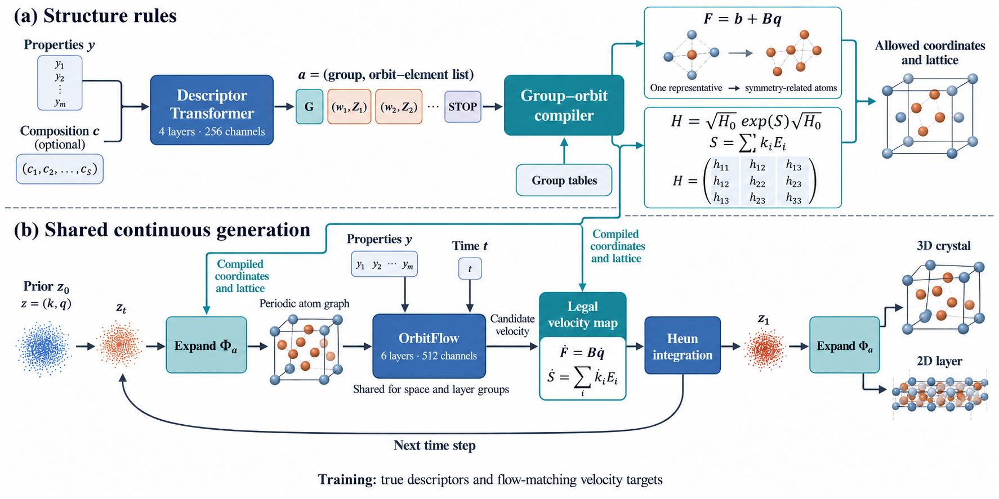

# UnifiedGroupGen 图表与结果整理

更新日期：2026年10月17日。服务器已停止，当前结果以下载的 `../tmp/UnifiedGroupGen.zip`（位于项目父目录的tmp）和经样本身份核验的本地MP20补充审计为准。原始日志中的running标志不再代表实时进程。

## 完成研究需要的结果与已有证据

| 研究问题 | 已有结果 | 仍需补齐 |
|---|---|---|
| 数据能否统一表示 | 102610条来源记录的群、轨道、元素、独立状态；本轮逐记录核对状态维数和展开原子数 | 将编码展开误差、群约束残差、轨道边界及观测约束测试整理为理论验证表 |
| 同一模型能否生成3D和2D | 联合模型完成198轮；历史最佳在第195轮，保有权重 | 先评价现有best，完成三来源测试及SG/LG生成；无需等待1000轮 |
| 已有三维生成是否符合规则 | MP20和MPTS52参考模型各128个输出，目标空间群记录为256/256匹配 | 更大样本、按自由度/群分层评价及共享模型结果 |
| 结构是否合理 | 244/256通过0.6 Å距离下限，255/256无轨道重合；MP20有补充半径/SMACT筛查 | MPTS52及联合模型同口径筛查；弛豫后的质量和失败分类 |
| 性质条件是否有效 | 已有条件输入和条件生成样本 | 独立性质评价、多档目标响应、CFG与有效性/多样性权衡 |
| 统一方法的作用在哪里 | 已实现共用编译和连续生成接口 | 同划分共享/独立对照、合法先验对照、兼容基线与必要消融 |
| 候选能否支持材料发现 | 已有可检查CIF | 统一物理评估预算下的能量、性质与必要的动力学验证 |

完整执行计划及口径见 [RESULTS_PLAN.md](results/RESULTS_PLAN.md)。近期先评价联合检查点，再补质量与条件效果；规则内容编码器、未见组合、磁性等扩展暂不混入已有模型结论。

## 数据集图

数据量是来源记录数，MP20与MPTS52存在重叠。各图默认合并原始train/val/test进行描述性统计，不能当成训练集覆盖率。

| 数据集 | 来源记录 | 群覆盖 | 元素种类 | 原始胞原子数中位数 | 标准胞原子数中位数 | 独立状态维数中位数 |
|---|---:|---:|---:|---:|---:|---:|
| MP20 | 45,229 | 179/230空间群 | 89 | 10 | 16 | 5 |
| MPTS52 | 40,476 | 208/230空间群 | 89 | 18 | 24 | 10 |
| C2DB项目子集 | 16,905 | 71/80层群 | 63 | 8 | 8 | 6 |

| 文件 | 展示内容 |
|---|---|
| [01_dataset_overview](datasets/01_dataset_overview.png) | 数据量、参考划分与联合划分、群目录覆盖 |
| [02_structure_complexity](datasets/02_structure_complexity.png) | 原始/标准胞原子数、轨道数、坐标/状态自由度和维数比例 |
| [03_symmetry_distribution](datasets/03_symmetry_distribution.png) | 完整空间群/层群编号上的记录频率，分轴展示 |
| [04_element_coverage](datasets/04_element_coverage.png) | 每种元素在多少比例的结构记录中出现 |
| [05_property_labels](datasets/05_property_labels.png) | 形成能、带隙、凸包能标签覆盖及完整经验分布 |
| [06_overlap_and_fixed_sites](datasets/06_overlap_and_fixed_sites.png) | 来源ID/CIF哈希交集、零坐标自由度结构占比 |
| [07_lattice_and_layer_geometry](datasets/07_lattice_and_layer_geometry.png) | 3D体积/原子、2D面积/原子、无真空层厚 |
| [property_coverage_recipe](datasets/property_coverage_recipe.png) | 技能配方生成的独立标签覆盖表，可用于展示 |

前7组同时提供PNG、PDF和保留文字的SVG；完整图注见 [datasets/README.md](datasets/README.md)。统计数据和102610条逐记录特征保存在 `datasets/tables/`，绘图源码为 [build_dataset_figures.py](datasets/source/build_dataset_figures.py)。

几个需要保留的事实：

- MP20与MPTS52共享19,819个材料ID，原始CIF字节哈希交集为19,862；两种标准不同，不相加。结构等价性仍可能超过字节哈希识别范围。
- C2DB带隙可用8,686/16,905（51.38%），MPTS52这份数据带隙标签为0条；缺失标签不补成物理零值。
- MP20/MPTS52标准胞最大分别达到80/208个原子，数据集名称中的20/52对应来源晶胞上限，不是标准胞上限。
- 群约束减少了参数维数，但维数减少比例不等于实际训练加速比例。
- 3D体积与2D面积分开统计；层厚由面外坐标极差定义，不包括真空和原子范德华半径。

## 架构图



描述Transformer生成带元素的群/轨道描述；确定性编译器构造合法独立状态和展开；共享OrbitFlow预测候选更新，经合法速度映射和Heun积分生成结构。训练连续模型使用真实描述。

该图由用户指定的 `ccf-visual-composer` 工作流配合内置图像生成工具完成，具体图像模型型号未由接口公开。图中结构为示意。PNG为栅格图，不声称原生矢量可编辑；完整输入规范、修正和科学口径保存在 [architecture_spec.md](architecture/source/architecture_spec.md)。

## 训练及已有生成结果

- [训练曲线](training/training_history.png)：原始验证点、最佳轮和停止位置；[口径说明](training/README.md)。
- [服务器原始生成计数](results/reference_generation_summary.png)：四组各64次；未评价项目明确标为Not evaluated。
- [MP20补充几何与化学筛查](results/mp20_additional_screening.png)：此前本地审计，128份CIF与本次备份逐一相同，权重及参考数据哈希一致。

| MP20补充筛查 | 无条件 | 条件 |
|---|---:|---:|
| 元素共价半径距离比≥0.6 | 56/64 | 39/64 |
| SMACT smact14价态筛查 | 58/64 | 54/64 |
| 对称性+距离+半径比+SMACT组合筛查 | 53/64 | 35/64 |

53/64和35/64是同一批MP20样本的组合筛查结果，**不是联合空间群/层群模型的生成结果**。SMACT筛查不等于稳定性认证。旧审计匹配身份及汇总保存在 [mp20_additional_screening.json](results/mp20_additional_screening.json)。训练/结果图的可复现源码为 [build_result_figures.py](training/source/build_result_figures.py)。

## 保存与复现

```text
assets/
  README.md
  datasets/       数据集图 PNG/PDF/SVG、图注、tables、source
  architecture/   架构PNG与source中的生成规范
  training/       训练曲线 PNG/PDF/SVG、图注、source
  results/        结果计划、生成/筛查图、来源绑定与计数
```

在已有项目环境中，从项目根目录运行：

```bash
python assets/datasets/source/build_dataset_figures.py --archive ../tmp/UnifiedGroupGen.zip
python assets/training/source/build_result_figures.py
```

统计依赖当前项目编译器及NumPy、pandas、Matplotlib、PyXtal环境；主图使用Times New Roman。配方附图在本机安装CCFA技能时额外生成SVG。本次PNG预览已检查；主统计图PDF/SVG由相同绘图对象导出。训练图读取父目录下此前建立的静态审计结果，额外MP20筛查读取原有本地审计及小型CIF备份。

本次只整理结果与生成图表，没有修改训练源码、恢复训练或推送GitHub。
