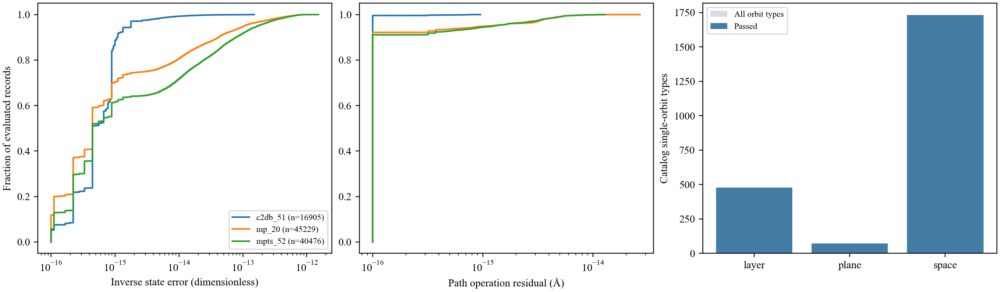

# 统一表示验证统计

2026-10-17本地执行结果。全部准备记录与完整目录检查已完成；来源CIF独立重编码是每来源16条的可复现抽查，不能写成全量原始CIF重构通过。

| 数据集 | 准备记录检查通过 | 独立参数逆映射最大误差 | 群操作最大残差/Å | 来源重新编码抽查通过 |
|---|---:|---:|---:|---:|
| MP20 | 45229/45229 | 8.43e-13 | 2.68e-14 | 16/16 |
| MPTS52 | 40476/40476 | 1.52e-12 | 1.29e-14 | 16/16 |
| C2DB | 16905/16905 | 1.50e-13 | 9.53e-16 | 16/16 |

完整目录检查：空间群230个、1731种单轨道；层群80个、477种单轨道；平面群17个、72种单轨道，合计2280种单轨道类型均通过秩、稳定子核维数、切向群作用和晶格检查。
真实记录的轨道基底秩与锚点约束核维数全部一致；切向群作用残差均为0。正定性、float64逆映射和三点路径抽查均通过。

左：独立参数逆映射误差；中：合法路径起点、中点、终点的最大群操作残差；右：完整目录检查计数。为使用对数横轴，图中0误差显示在1e-16处，原始数值仍保留0。

- [完整汇总及输入指纹](summary.json)
- [102610条逐记录统计，压缩CSV](records.csv.gz)
- [完整目录统计](catalog.csv)
- [48条来源独立重编码统计](source_reencoding.csv)
- [服务器复现与指标解释](../../docs/STANDARD_EVALUATION.md)

准备记录的内部一致性、来源标准化可复现性、原始结构被理想化的变化是不同问题。C2DB已有的原始→标准化误差单列于汇总；旧3D记录缺失的原始理想化误差不补0。
重新编码使用与历史记录相同的识别容差和标准胞约定，比较时允许同元素重排和共同原点平移，未比较任意晶胞基底变换。全量来源复验应在服务器执行默认不限制来源的命令。
这些统计不涉及学习器质量、性质命中或物理稳定性，也不证明当前代码支持任意群作用。

> 2026-10-19结果同步：联合训练已在245轮早停，49次验证；最优仍为第195轮。新包最优权重、七组评估输出及数据划分已核验一致。当前结果以 `assets/results/current_snapshot.json` 为准，完整更新清单见 `docs/RESULTS_UPDATE_20261019.md`。本次未新增性质或稳定性认证。
